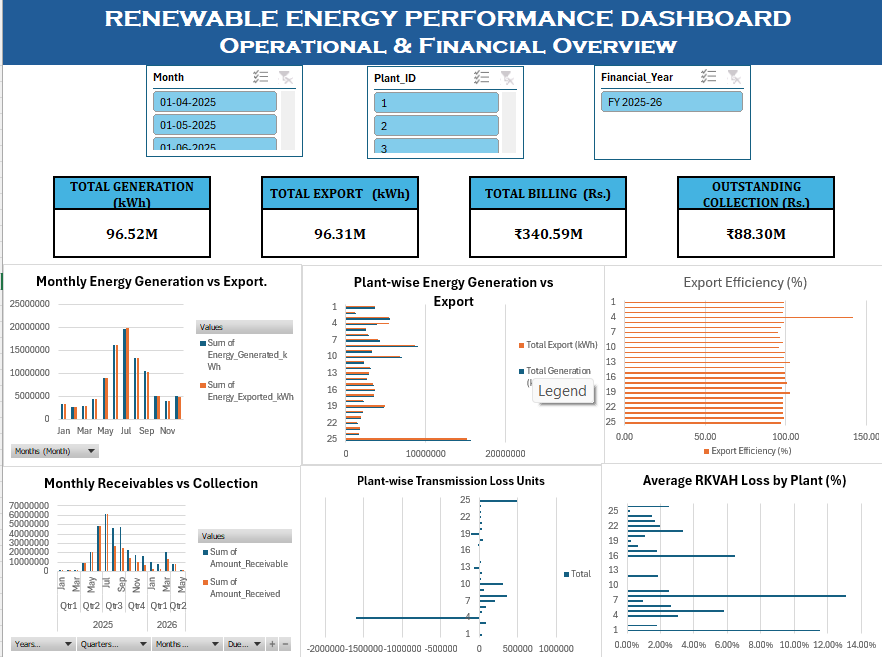
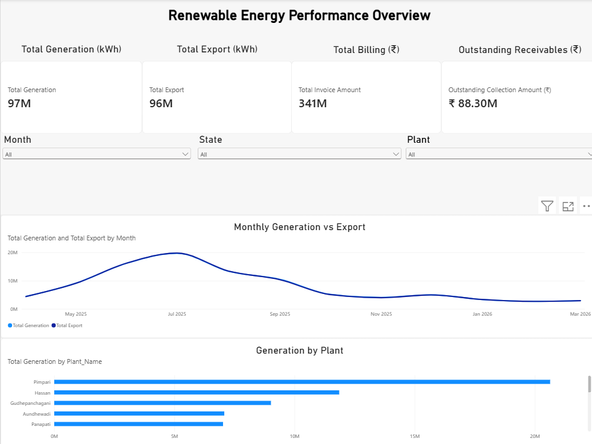
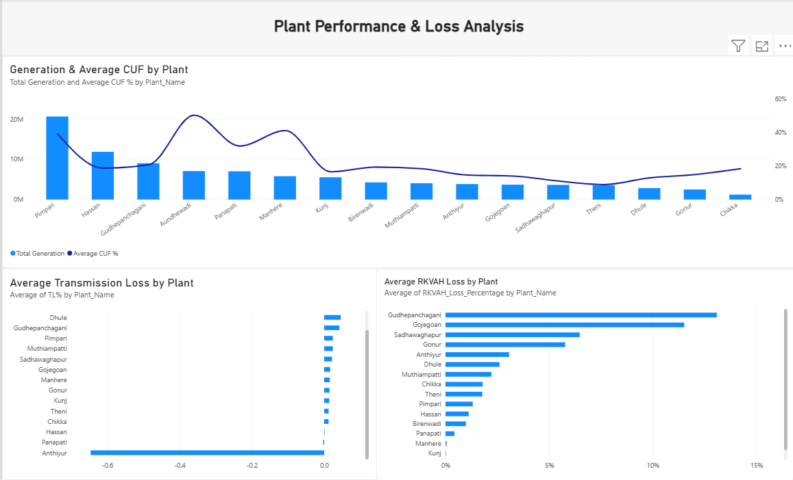
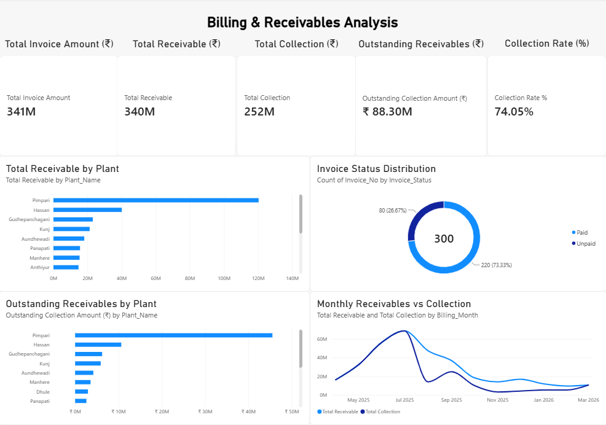

# Renewable Energy Performance Analysis

An end-to-end analytics project focused on renewable energy generation, plant performance, billing, receivables, collections, transmission losses, and RKVAH losses using Microsoft Excel, PostgreSQL, SQL, and Power BI.

## Project Overview

Renewable energy businesses need clear visibility into energy generation, plant-level performance, billing, and collections. This project analyzes operational and financial data to develop interactive dashboards, monitor key performance indicators (KPIs), and identify data patterns requiring further investigation.

The project combines Excel analysis, SQL queries, and Power BI dashboards to present operational and financial information in a business-focused format.

## Project Objectives

- Analyze monthly energy generation and export.
- Compare generation and export across plants.
- Monitor billing, receivables, and collections.
- Track outstanding collection amounts.
- Analyze transmission losses and RKVAH losses.
- Develop interactive dashboards for operational and financial reporting.
- Identify data-quality issues that require further validation.

## Tools and Technologies

| Tool | Purpose |
|---|---|
| Microsoft Excel | Data analysis, PivotTables, PivotCharts, KPIs, and interactive dashboard |
| PostgreSQL | Relational database and SQL analysis |
| SQL | Data aggregation, joins, filtering, and business analysis |
| Microsoft Power BI | Interactive dashboards, visualizations, data modelling, and DAX |

## Project Workflow

1. **Excel Analysis:** Analyze operational and financial data using PivotTables, charts, and slicers.
2. **SQL Analysis:** Use analytical queries to investigate generation, billing, collections, plant performance, and losses.
3. **Power BI Reporting:** Build interactive dashboards to visualize operational and financial KPIs.
4. **Business Analysis:** Interpret performance patterns and identify data-quality issues requiring investigation.

---

# 1. Excel Analysis

The Excel workbook contains data analysis sheets, PivotTables, PivotCharts, and an executive dashboard with interactive slicers.

## Executive Dashboard

The dashboard provides a consolidated view of energy generation, energy export, billing, collections, and operational loss indicators.



### Dashboard Features

- Total energy generation and export
- Total billing
- Outstanding collection amount
- Monthly generation versus export
- Plant-wise generation versus export
- Plant-wise export efficiency
- Monthly receivables versus collection
- Transmission loss analysis
- Average RKVAH loss by plant
- Interactive Month, Plant ID, and Financial Year slicers

**Excel Workbook:** `01_Excel_Analysis/Renewable_Energy_Analytics.xlsx`

[Explore Excel Analysis](01_Excel_Analysis/)

---

# 2. Power BI Dashboard

The Power BI report contains three analytical pages covering operational performance, plant-level losses, and financial collections.

## Page 1: Renewable Energy Performance Overview

- Total energy generation
- Total energy export
- Total billing
- Outstanding collection amount
- Monthly generation versus export
- Plant-level performance overview



## Page 2: Plant Performance & Loss Analysis

- Plant-wise energy generation and export
- Capacity Utilization Factor (CUF)
- Transmission loss analysis
- RKVAH loss analysis



## Page 3: Billing & Receivables Analysis

- Total invoice amount
- Total receivables and collections
- Outstanding collection amount
- Invoice status distribution
- Monthly receivables versus collection
- Plant-wise outstanding receivables



**Power BI Report:** `02_Power_BI/Renewable_Energy_Analytics.pbix`

[Explore Power BI Files](02_Power_BI/)

---

# 3. SQL Analysis

SQL was used to analyze operational and financial performance, compare plants, and investigate billing and collection patterns.

### Analysis Areas

- Monthly energy generation and export
- Plant-wise performance comparisons
- Billing and receivables
- Collection performance
- Outstanding amounts
- Transmission losses
- RKVAH losses
- Aggregations, joins, conditional logic, and analytical queries

**SQL Script:** `03_SQL/Renewable_Energy_Analysis.sql`

[Explore SQL Analysis](03_SQL/)

---

# Key Performance Indicators

The following figures represent project-level totals recorded in the dashboards before interactive filters are applied.

| KPI | Reported Value |
|---|---:|
| Total Energy Generation | 96.52 million kWh |
| Total Energy Export | 96.31 million kWh |
| Total Billing | Approximately ₹340.59 million |
| Total Receivables | Approximately ₹340.25 million |
| Total Collection | Approximately ₹251.95 million |
| Outstanding Collection Amount | Approximately ₹88.30 million |
| Collection Rate | Approximately 74.05% |

**Metric definitions:** Outstanding collection amount is calculated as receivables minus amounts received. It differs from the billing-table difference between invoice amount and amount receivable.

These values are based on the current project data and may differ from filtered dashboard results.

---

# Data Quality Considerations

The analysis identified patterns that require validation before definitive operational conclusions can be drawn.

- **Negative transmission loss values:** Certain records contain negative transmission-loss units. The underlying source records, calculation methods, and measurement definitions require investigation.
- **Export efficiency above 100%:** Certain plants show export efficiency above 100%. These values require validation against source measurements and business definitions.
- **Metric interpretation:** Energy units, loss units, and loss percentages should be interpreted separately and not compared on an inappropriate common scale.

Unusual values are documented as data-quality observations rather than automatically treated as confirmed operational errors.

---

# Business Value

This project demonstrates how analytics can support renewable energy operations through:

- Consolidated operational and financial reporting
- Monitoring of energy generation and export
- Plant-level performance comparisons
- Billing and collection visibility
- Identification of unusual operational measurements
- Interactive dashboards for business users
- Data-driven investigation and reporting

---

# Repository Structure

```text
renewable-energy-performance-analysis/
│
├── README.md
│
├── 01_Excel_Analysis/
│   ├── README.md
│   ├── Renewable_Energy_Analytics.xlsx
│   └── Renewable_Energy_Analytics_Dashboard.png
│
├── 02_Power_BI/
│   ├── README.md
│   ├── Renewable_Energy_Analytics.pbix
│   ├── dashboard_overview.png
│   ├── plant_performance.png
│   └── billing_receivables.png
│
└── 03_SQL/
    ├── README.md
    └── Renewable_Energy_Analysis.sql
